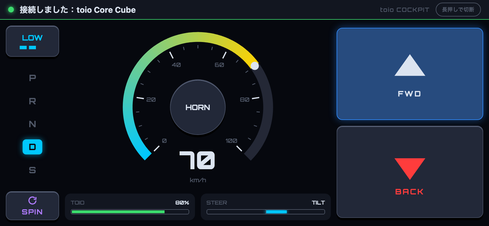

# toio-cockpit-web

ブラウザから toio を操作する Web ページ。ボタンで前後に走り、スマホの傾きで曲がる。URLは以下

[**https://teach310.github.io/toio-cockpit-web/**](https://teach310.github.io/toio-cockpit-web/)

iPhone の Safari と Chrome は Web Bluetooth に対応していないため、[Bluefy](https://apps.apple.com/jp/app/bluefy-web-ble-browser/id1492822055) アプリのインストールが必要です

## 使い方

1. スマホを横向きにしてページを開く
2. 右上の **CONNECT** をタップし、傾きセンサーの許可と toio の選択をする
3. 右の **▲ FWD** / **▼ BACK** を押している間だけ走る。スマホを左右に傾けると曲がる

| 操作           | 動き                                                 |
| ------------ | -------------------------------------------------- |
| FWD / BACK   | 押している間、前進 / 後退する。加速・減速はなめらか。後退中はバック音が鳴る            |
| 傾き           | 車のハンドルのように左右に回すと曲がる（平置きで傾けても同じ）。後退中は車のバックと同じ向きに曲がる |
| SPIN（左下）     | 押している間、その場で右に速く回る。ほかの操作より優先                        |
| HORN（メーター中央） | 押している間クラクションが鳴る                                    |
| 速さのギア（左上）    | タップで SLOW → LOW → HIGH を切り替える。次に開いたときも残る           |
| 長押しで切断（右上）   | 1.5 秒長押しで切断する。子どもが間違えて切らないよう長押しにしている               |
| STEER（右下）を長押し | 1.5 秒長押しで傾きの向きを反転する（表示が TILT REV になる）。機種によって逆になることがあるため。端末ごとに保存される |
| AUTO（右上）   | オートモードに切り替える。動き4つ（約10秒で止まる）・音12個のボタンで toio が自動で動く・鳴る。もう一度押すと止まる |
